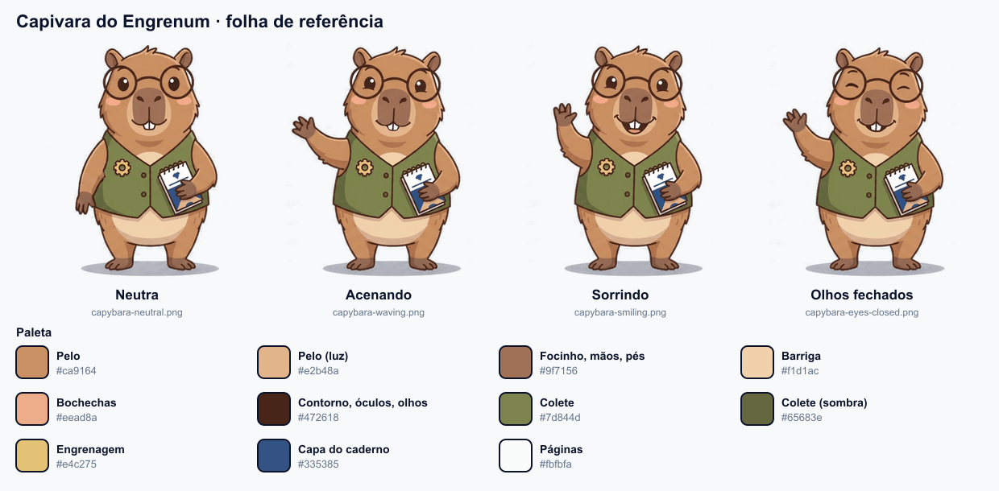

# Capivara do Engrenum: referências

Material de base para criar novas poses, animações e artes da mascote mantendo a mesma personagem. Esta pasta **não vai para o app**; os arquivos usados no app ficam em [`public/mascot/`](../../public/mascot).

## Poses

Todas em PNG, **480×620 px**, com **fundo transparente**, recortadas dos quadros originais do vídeo (sem a redução usada no app).

| Arquivo | Pose | Bom para |
|---|---|---|
| [`capybara-neutral.png`](capybara-neutral.png) | Em pé, braços para baixo, olhos abertos | **Referência principal** para gerar poses novas |
| [`capybara-waving.png`](capybara-waving.png) | Acenando, boca fechada | Boas-vindas, dicas, convites |
| [`capybara-smiling.png`](capybara-smiling.png) | Acenando com sorriso aberto | Acertos, comemorações, conquistas |
| [`capybara-eyes-closed.png`](capybara-eyes-closed.png) | Olhos fechados, sorrindo | Cochilo, estados bloqueados ou "em breve" |

## A personagem

- **Capivara** em estilo cartoon plano, com contorno marrom-escuro grosso e sombreamento suave.
- **Óculos redondos** de aro fino marrom-escuro.
- **Colete verde-oliva** com dois botões e um **broche de engrenagem dourada** no peito, que remete ao nome Engrenum.
- Segura um **caderninho de espiral** de capa azul contra o corpo, com a mão esquerda.
- Bochechas rosadas e dois dentes da frente aparentes.
- Sombra oval cinza-clara no chão.

## Paleta

| Parte | Cor |
|---|---|
| Pelo | `#ca9164` |
| Pelo (luz) | `#e2b48a` |
| Focinho, mãos e pés | `#9f7156` |
| Barriga | `#f1d1ac` |
| Bochechas | `#eead8a` |
| Contorno, óculos e olhos | `#472618` |
| Colete | `#7d844d` |
| Colete (sombra) | `#65683e` |
| Engrenagem | `#e4c275` |
| Capa do caderno | `#335385` |
| Páginas | `#fbfbfa` |

As cores foram medidas nos quadros do vídeo. Pequenas variações de tom entre quadros são normais.

## Criando novas poses ou animações

1. **Use `capybara-neutral.png` como referência** na ferramenta de geração e descreva a personagem com os itens da seção acima: óculos, colete com engrenagem e caderninho azul.
2. **Peça fundo branco liso**, sem gradiente nem cenário, com a personagem inteira enquadrada e uma sombra simples no chão. Isso facilita remover o fundo depois.
3. **Mantenha a paleta e o contorno.** Evite que a ferramenta mude o colete, os óculos ou as proporções.
4. **Para animações curtas,** prefira movimentos que voltem à pose inicial (acenar, piscar, pular), para o loop não ter emenda.

### Do vídeo ao arquivo do app

O processo usado para gerar `public/mascot/capybara-wave.webp`:
1. **Escolher o trecho do loop:** comparar todos os pares de quadros e pegar um início e um fim quase idênticos.
2. **Recortar** a personagem.
3. **Remover o fundo** com preenchimento a partir das bordas da imagem. Assim, os brancos internos (páginas e brilho dos olhos) não são apagados, e a sombra do chão vira uma sombra semitransparente.
4. **Reduzir** para 10 fps e 180 px de altura.
5. **Congelar o corpo** a partir de um quadro de referência, animando só o que se mexe de verdade. Vídeos gerados por IA "tremem" em todos os contornos, e isso multiplica o tamanho do arquivo.
6. **Exportar** como WebP animado.

Limites de tamanho e formato: veja a seção 7 do [`CLAUDE.md`](../../CLAUDE.md). Resumindo, a animação deve ter **até 50 KB** e as imagens paradas **até 10 KB**, em WebP (não GIF).

**Fonte:** vídeo gerado com IA (`gemini_generated_video_4e6d09d3.mp4`, 1280×720, 10 s), que não está no repositório.
